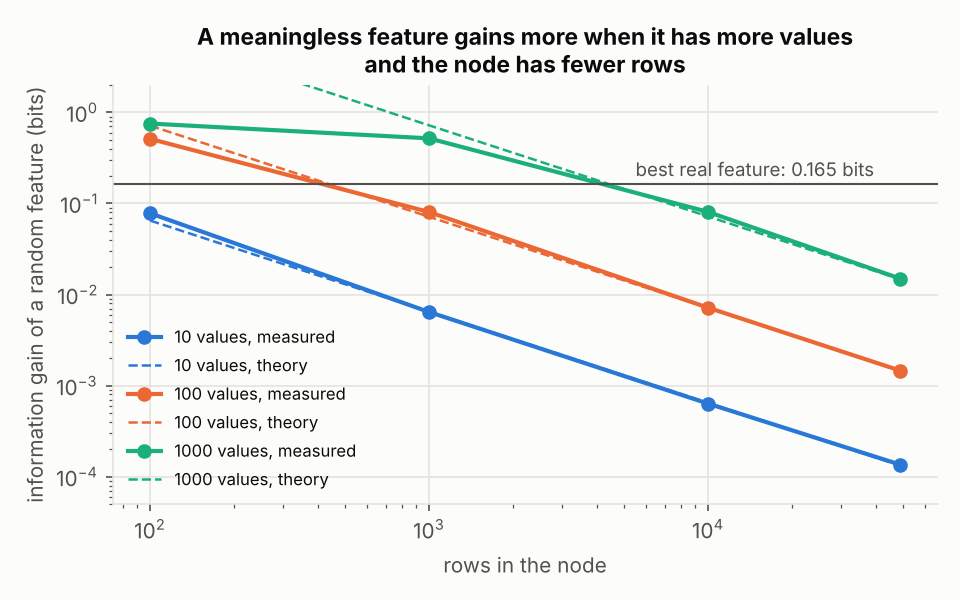
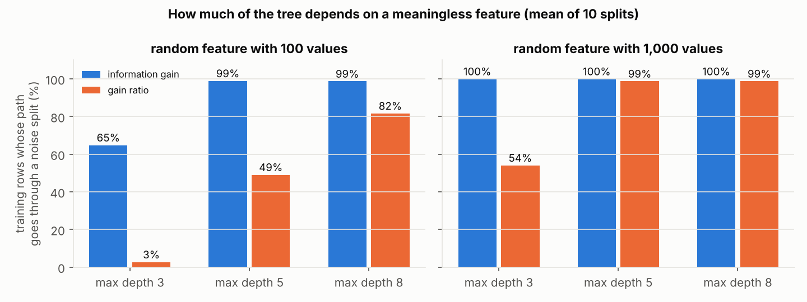
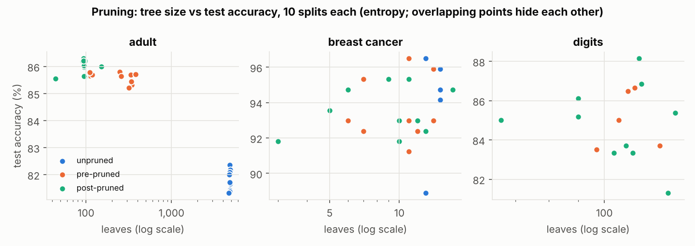
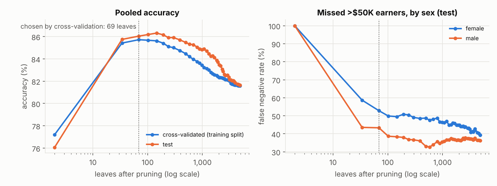

# Optimizing Decision Trees with Information Theory


## For readers

This is a research paper and presentation from **CPS 372 Information Theory** at Franklin &
Marshall College (Fall 2024), written by **Thanh Vu and Nam** as a two-person final project.

It explains how decision trees use **entropy** and **information gain** to choose splits, and
how **feature selection** and **pruning** keep trees from overfitting. The paper itself is a
survey with worked examples. In October 2026 I added an AI-assisted **follow-up study** (`study/`) that
tests three of its claims with experiments on real data; the results are at the end of this
page.

| File | What it is |
|---|---|
| [`paper/decision-trees-information-theory-paper.pdf`](paper/decision-trees-information-theory-paper.pdf) | 18-page paper: entropy and information gain, feature selection, pre- and post-pruning, imbalanced data |
| [`paper/information-in-decision-trees-slides.pdf`](paper/information-in-decision-trees-slides.pdf) | 26-slide class presentation (one slide with a third-party image removed) |
| [`analysis/check_examples.py`](analysis/check_examples.py) | Recomputes every worked example in the paper and slides (see the analysis below) |
| [`study/`](study/) | Follow-up study: a from-scratch ID3/C4.5-style tree, a checksum-verified data pipeline, three experiments, tests and figures |

**Reading guide.** For the information theory, read section 2 of the paper (entropy and
information gain, with worked examples). For the practical machine-learning side, read the
pruning section, which works through cost-complexity pruning, reduced-error pruning, minimum
impurity decrease and minimum leaf size step by step, using a contact-lens tree.

## What the paper covers

1. **Decision tree basics.** Root, decision and leaf nodes, and the trade-offs: interpretable
   and no feature scaling needed, but prone to overfitting, unstable, and biased toward
   features with many levels.
2. **Entropy and information gain.**
   H(S) = −Σ pᵢ log₂ pᵢ and IG(S, A) = H(S) − Σ (|Sᵥ|/|S|) H(Sᵥ), with worked examples.
3. **Feature selection.** Dropping low-information features to get a simpler tree with the
   same predictive power.
4. **Pruning.** Pre-pruning (maximum depth, minimum samples per leaf or split, maximum leaf
   nodes, chosen by k-fold cross-validation) and post-pruning (cost-complexity with α,
   reduced-error, minimum impurity decrease, minimum leaf size).
5. **Imbalanced data.** Oversampling with SMOTE and random undersampling.

## Independent analysis

This review was written after the course. It recomputes every number in the paper and slides
(`python analysis/check_examples.py`) and reads the claims against standard references.

### What holds up

- **The paper's worked example is right.** For 6 Yes / 4 No, H(S) = 0.971. Splitting into
  (3 Yes, 1 No) and (3 Yes, 3 No) gives a weighted entropy of 0.925 and a gain of 0.046. The
  paper rounds these to 0.97, 0.92 and 0.05.
- **The Weather split on the slides is right.** IG = 1.0 − 0.459 = 0.541.
- **The pruning section is the most useful part.** It separates feature selection (which
  removes inputs *before* training) from pruning (which removes branches, while the same
  feature may still be used elsewhere in the tree). Each pruning method comes with steps,
  benefits and drawbacks. The cost-complexity rule, cost = error + α × size, is stated
  correctly.

### What does not hold up

**1. The Humidity example on the slides is miscounted.** The slides say the High group has
"2 No, 1 Yes" and Normal has "2 Yes", which gives IG = 0.541, the same as Weather. The
table on the same slide has four High rows (2 No, 2 Yes) and two Normal rows (1 Yes, 1 No).
Both groups are 50/50, so **IG(Humidity) = 0**: Humidity tells you nothing in this table.

| Split | Information gain (slides) | Recomputed | Gain ratio |
|---|---|---|---|
| Weather (3 values) | 0.541 | 0.541 | 0.371 |
| Humidity (2 values) | 0.541 | **0.000** | 0.000 |
| Wind (2 values) | not shown | **0.459** | **0.500** |

The table also shows something the paper only mentions. Information gain picks Weather,
but **gain ratio** (C4.5's correction for the many-levels bias the paper lists as a
disadvantage) picks Wind. That would be a strong example to add, because it ties the bias to
an information-theoretic fix.

**2. The abstract promises experiments that are not there.** It says the study "offers
experimental results confirming the suitability of decision trees". The paper has worked
examples and illustrative trees, but no dataset, no trained model and no measured accuracy.
The contact-lens pruning example also uses assumed numbers: it assumes the "Hard" leaf accounts for 99% of one branch's accuracy.
In the well-known contact-lens dataset (Cendrowska, 1987), every patient with a reduced tear
rate gets no lenses, so that branch would be a single leaf rather than the subtree drawn.

**3. Two statements contradict each other or overreach.**
- *Minimum impurity decrease.* The description says that a split below the threshold has
  "affected the performance … so it is advisable not to prune". The step-by-step guide
  directly below it says to prune such splits. The step-by-step version is the standard one.
- *Pre-pruning "performs poorly when exposed to new data"* and post-pruning "demands
  high-quality processors". Both are too strong. Pre-pruning with limits chosen by
  cross-validation (maximum depth, minimum samples per leaf) is standard practice and often
  generalizes well. Post-pruning a single tree is
  cheap.

**4. A missed connection to the course.** Information gain *is* the mutual information
between the split and the label, IG(S, A) = I(Y; A). Saying so would link decision trees to
the core of an information theory course. The Gini range of 0 to 0.5 holds for two classes
only; with k classes the maximum is 1 − 1/k.

**5. Two citations need correcting.**
- *Application of Information Theory to the Construction of Efficient Decision Trees* is by
  C. R. P. Hartmann, P. K. Varshney, K. G. Mehrotra and C. L. Gerberich, *IEEE Transactions on
  Information Theory*, 1982. It is not by Meila and Jordan.
- Safavian and Landgrebe's survey appeared in *IEEE Transactions on Systems, Man, and
  Cybernetics* 21(3):660–674, 1991, not in *Pattern Recognition*.
- Most of the other sources are blog posts. The paper would be stronger citing Quinlan (ID3,
  1986; C4.5, 1993) and Breiman et al. (CART, 1984) directly.

### What this project shows

A clear grasp of how entropy drives tree construction, and a practical, well-organized
account of pruning. The errors are in hand-worked numbers and in claims that were not
tested. The follow-up study below tests them.

## Reproduce the check

```bash
python analysis/check_examples.py   # standard library only
```

## Follow-up study (October 2026): testing the paper's claims

The review above found that the paper makes claims it never tests. This study tests three
of them on the [UCI Adult census-income data](https://archive.ics.uci.edu/dataset/2/adult)
(48,842 people; predict whether income is above $50K), plus two small scikit-learn datasets
for comparison.

| Experiment | Claim tested | Short answer |
|---|---|---|
| E1 | Information gain is "biased toward features with many levels" | True, and the size of the bias follows a formula from information theory. Gain ratio reduces it but does not remove it |
| E2 | Pre-pruning "performs poorly when exposed to new data"; post-pruning "demands high-quality processors" | Neither holds. Both pruning methods beat the full tree by about 4 points on Adult, and post-pruning took 26 seconds on 2 cores |
| E3 | (new question) Does a pruning choice made on pooled accuracy hide changes for particular groups? | Yes. Pruning raised accuracy for every group but widened the gap in missed high earners between women and men |

### E1. The many-levels bias, measured

For a feature with K values that has nothing to do with the label, the information gain
measured on n rows is not zero. 2n ln 2 × IG is approximately chi-squared with K − 1
degrees of freedom (the G-test), so the expected spurious gain is about
**(K − 1) / (2n ln 2) bits**.

**Part A: the formula holds.** Random features scored against the real Adult labels, 200
draws per cell, match the formula closely when n is much larger than K. On all 48,842
rows: 0.00146 measured vs 0.00146 predicted for K = 100. For K = 1,000 (only about 49 rows
per value) the measured gain is 0.0150 against 0.0148 predicted, about 2% higher. That gap
is small but real (well outside sampling error), and it grows as rows per value fall: the
chi-squared approximation gets worse. When K approaches n the formula breaks down, because gain cannot exceed the
label entropy (0.79 bits). The practical point: by the formula, a random 1,000-value feature
beats the best real feature at the root (`relationship`, 0.165 bits) in any node with fewer
than about 4,400 rows. A random 100-value feature does so below about 430 rows.



**Part B: what it does to a tree.** One random feature with K values was added to 12 real
categorical features, and trees were grown with a from-scratch ID3/C4.5-style
implementation (`study/src/tree.py`) using information gain or gain ratio. Each tree is
compared with the same tree grown without the noise feature, over 10 random 70/30 splits.

| Random feature | Max depth | Training rows routed through a noise split (gain / gain ratio) | Test accuracy change (gain / gain ratio) |
|---|---|---|---|
| 100 values | 3 | 65% / 3% | −1.3 / −0.1 points |
| 100 values | 5 | 99% / 49% | −4.0 / −1.1 points |
| 100 values | 8 | 99% / 82% | −3.6 / −2.5 points |
| 1,000 values | 3 | 100% / 54% | −5.1 / −3.7 points |
| 1,000 values | 5 | 100% / 99% | −5.2 / −4.8 points |
| 1,000 values | 8 | 100% / 99% | −4.2 / −4.1 points |



- The noise feature was never chosen at the root, where the node holds all 34,189 training
  rows. With 1,000 values it was chosen one level down in every run, because those nodes
  are smaller. This is the formula at work: the bias is worst deep in the tree.
- Gain ratio, C4.5's fix, cuts the damage for a 100-value feature at every depth (3% vs 65%
  of rows at depth 3, 49% vs 99% at depth 5, 82% vs 99% at depth 8). With 1,000 values and
  depth 5 or more it is fooled almost as badly as plain information gain.
  In a small node nearly every row has its own noise value, so the split looks perfectly
  pure, and dividing by the split information does not offset that.
- Without a noise feature, gain ratio was slightly more accurate (82.8% vs 82.6% at depth 3,
  82.1% vs 81.5% at depth 8) and its depth-3 trees were much smaller (192 to 266 leaves vs
  539 to 655; column `leaves_without_noise` in `e1_trees.csv`).
- One caveat on the gain-ratio column: C4.5 only considers features whose gain is at least
  the average gain, and adding any extra column changes that average. So part of each
  gain-ratio accuracy change comes from the threshold moving, not from splits on noise. A
  2-value noise column that is never split on still changes most gain-ratio trees.

Full C4.5 also refuses splits whose branches are too small and prunes afterwards; those are
left out here on purpose, to isolate the splitting criterion.

### E2. Pre-pruning vs post-pruning

scikit-learn trees, 10 stratified 70/30 splits per dataset. Pre-pruning tunes `max_depth`
and `min_samples_leaf` by 5-fold cross-validation (30 combinations); post-pruning tunes
`ccp_alpha` from the cost-complexity path by 5-fold cross-validation (up to 31 values). Means over
the 10 splits, entropy criterion:

| Dataset | Rows | Test accuracy: unpruned / pre / post | Leaves: unpruned / pre / post | Tuning time (s): pre / post |
|---|---|---|---|---|
| Adult | 48,842 | 81.8 / 85.6 / 86.0 | 4,787 / 256 / 95 | 14 / 26 |
| Breast cancer | 569 | 93.9 / 93.8 / 93.6 | 14 / 10 / 10 | 0.4 / 0.2 |
| Digits | 1,797 | 85.1 / 85.0 / 84.8 | 117 / 116 / 106 | 1.1 / 1.5 |



- **On Adult, pruning matters a lot.** Both methods beat the full tree by about 4 points in
  every split, with trees about 19 to 50 times smaller. Post-pruning beat pre-pruning by 0.4 points
  on average (in 19 of 20 split-and-criterion pairs) with about a third as many leaves.
- **On the two small datasets, it does not.** No method differed by more than the
  split-to-split variation (standard deviation 0.6 to 2.6 points).
- **The paper's claims do not hold.** Pre-pruning with limits chosen by cross-validation was
  within 0.4 points of post-pruning (0.5 with Gini), not "poor". Post-pruning cost about twice the tuning
  time of pre-pruning, but that was 26 seconds on a 2-core machine for 34,000 training rows.
- **Entropy vs Gini made little difference**: at most 0.6 points apart on Adult and breast
  cancer, less than the split-to-split variation; entropy was 0.7 to 0.9 points ahead on
  digits.

### E3. What pooled accuracy hides

For each Adult model in E2, the test errors were broken down by sex and race. The false
negative rate (FNR) is the share of people who earn more than $50K whom the model misses.
Means over 10 splits, entropy criterion, unpruned → post-pruned:

| Group | Share earning >$50K | Accuracy | False negative rate |
|---|---|---|---|
| All | 23.9% | 81.8% → 86.0% | 37.3% → 38.2% |
| Women | 10.8% | 89.9% → 93.2% | 43.0% → 46.7% |
| Men | 30.4% | 77.8% → 82.4% | 36.3% → 36.7% |
| White | 25.4% | 81.0% → 85.3% | 36.9% → 38.1% |
| Black | 12.1% | 88.9% → 92.2% | 43.1% → 42.3% |
| Other races | 21.8% | 82.2% → 86.2% | 38.4% → 35.6% |



- **Accuracy hides the problem.** The model is more accurate for women (93%) than for men
  (82%) only because far fewer women in this data earn more than $50K. Predicting "no" for
  every woman would already score 89%. Among women who do earn more than $50K, the pruned
  tree misses 47%, against 37% for men.
- **Pruning widened the gap.** Pruning gains its accuracy by cutting false positives (12.2%
  → 6.4% overall). Along the way women's FNR rose 3.7 points and men's 0.5 points, so the
  gap grew from 6.7 to 9.9 points. It widened in 7 of 10 splits, for both entropy and Gini.
  On the single split plotted above, women's FNR goes from 39% for the full tree to 53% at
  the cross-validated choice of 69 leaves; men's goes from 36% to 43%. That exact choice
  depends on the alpha grid: E2's coarser grid picks 91 leaves on the same split (women
  50%, men 39%). The direction is the same.
- **The race groups show no consistent pattern.** With about 170 Black and 160 "other
  races" positive cases per test split, these estimates are noisy.

### Data pipeline and tests

- `study/data/fetch_adult.py` downloads the data, checks its SHA-256 so every run uses the
  same bytes, validates the schema (15 columns, numeric types, exactly two labels) and writes
  [`quality_report.json`](study/data/quality_report.json): 48,842 rows, 3,620 with a missing
  value, 52 exact duplicates. Rows with missing values are kept, with the missing value
  recorded as its own category, because dropping them would remove some groups more than
  others.
- `study/tests/` (8 tests, `pytest`) checks the tree against the paper's and slides' worked
  examples, checks that the two criteria choose different roots on the slides' table, and
  checks the spurious-gain formula by simulation.
- Every number above is in a CSV in `study/results/`; `study/make_figures.py` draws the
  figures from those files.

### Limitations

- Adult is 1994 census data, and the $50K threshold is not adjusted for inflation. A modern
  replacement such as the Folktables ACS income task would be a better test of E3.
- Sex and race are used as input features, as in the standard benchmark. E3 measures error
  rates; it does not fix them or claim anything about a deployed system. Differences in FNR
  also reflect different base rates and features, not only the pruning.
- E1 uses one dataset and a simplified C4.5 (no minimum branch size, no numeric thresholds,
  no pruning). E2's `ccp_alpha` grid is 30 quantiles of the pruning path, not every value.
- Ten splits per setting; timings are from a 2-core cloud machine.

### How this was made

The paper and slides are our Fall 2024 coursework (Thanh Vu and Nam). The follow-up study
and the analysis of the paper were designed and run in October 2026 by an AI assistant
(Claude) at my request; it wrote most of the code and text in `study/` and `analysis/`.

### Reproduce the study

```bash
pip install -r study/requirements.txt
bash study/run_all.sh     # about an hour on 2 cores; or run the steps inside it one by one
```
